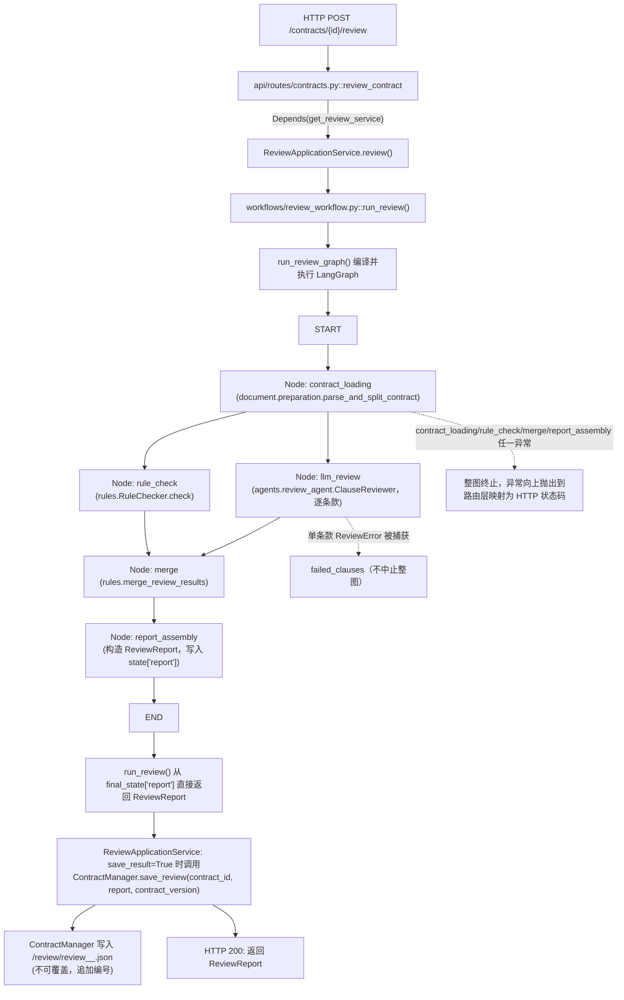

# labor_contract_review 项目架构盘点（本轮：2026-10-13）

标签说明：`CONFIRMED`=本轮通过设备端 `device_list_dir`/`device_stage_files`+`Read` 直接核实（真实文件内容或真实目录结构）；`REPORTED`=来自已有报告/历史记录，本轮未重新核实；`INFERRED`=基于本轮已核实证据推理得出；`UNKNOWN`=证据不足，需要下一轮补充核实。

## 0. 本轮实际核实范围（先说清楚"看了什么"）

**本轮通过 `device_list_dir`（递归，按顶层目录分别调用）实际扫描的目录**（CONFIRMED，结构已记录在本次对话的工具结果中）：
`api/`、`application/`、`agents/`、`workflows/`、`contract/`、`document/`、`rag/`、`rules/`、`schemas/`、`modification/`、`diff/`、`evaluation/`、`config/`、`llm/`、`prompts/`、`scripts/`（根级）、`data/`、`docs/`（仅列表，未逐篇读取）、`tests/`、`output/`、`frontend/`+`frontend/src/`、`experiment_kb/` 全部子目录（`baseline/`、`working/`、`reference_only/`、`datasets/`、`diff_reports/`、`results/`、`scripts/`、`snapshots/`、`tmp_runtime/`、`whitelist/`）。

**本轮通过 `Read` 实际逐字读取的源码文件**（CONFIRMED，内容已在本轮对话中完整出现）：
`api/app.py`、`api/dependencies.py`、`api/routes/contracts.py`、`api/routes/modification.py`、`application/review_service.py`、`workflows/review_workflow.py`、`contract/manager.py`、`config/settings.py`、`rag/database.py`、`rag/retriever.py`、`schemas/contract.py`、`schemas/contract_version.py`、`schemas/clause.py`、`schemas/evidence.py`、`schemas/review_report.py`、`experiment_kb/results/RAG_EXPERIMENT_REGISTER.csv`（全文）。

**本轮未能到达的部分**（UNKNOWN，不是"假设不存在"，是"没看"）：`.idea/`、`.pytest_cache/`、`.venv/`、`venv/` 内部（遵照指令只记录体量/用途，不展开）；`tree.txt`（5.6MB）、`Labor_Contract_Review_Project_Report.md`、`README.md` 三个既有文档未读取（为避免被旧文档的历史断言污染本轮的"真实设备核查"结论，故意不作为证据来源，只在 OPEN_QUESTIONS 中列为"可交叉核对但本轮未用"）；`docs/`、`tests/`、`scripts/`（根级29个）、`experiment_kb/scripts/`（5个）内部文件均只核实了**存在性与字节大小**，未逐篇打开读取内容——涉及它们的结论全部标注为 REPORTED 或 UNKNOWN，不冒充 CONFIRMED。

## 1. 顶层目录分类表

| 目录 | 归类 | 依据 | 标签 |
|---|---|---|---|
| `api/` `application/` `agents/` `workflows/` `contract/` `document/` `rag/` `rules/` `schemas/` `modification/` `diff/` `config/` `llm/` `prompts/` | 正式业务代码 | 本轮逐文件读取或至少逐文件列出，命名空间与 FastAPI 路由直接对应 | CONFIRMED |
| `frontend/` | 正式业务代码（前端 SPA） | `src/App.jsx`(24219B)+`src/api/client.js`(14951B)+14个组件+`vite.config.js`+`package.json`，真实 React+Vite 项目结构 | CONFIRMED |
| `data/` | 运行态数据（业务） | `contracts/`(22个真实 UUID 目录)、`chroma/`(401408B sqlite3+2个HNSW目录)、`knowledge/`(正式26条法律知识库文本)、`eval_samples/`(历史评测原始数据，见下) | CONFIRMED |
| `evaluation/` | 评测数据生成代码 | `generate_contracts.py`(15027B)+`clause_bank.py`(40228B) 是生成 `data/eval_samples/contracts` 50份合成合同的真实程序（已被 A003 轮验证：50份合同的 `source=newly_designed`） | CONFIRMED |
| `scripts/`（根级29个文件） | 实验评测脚本库 | 命名全部是 `eval_*`/`verify_*`/`build_*`，对应历史 E001-E010 级别的 Dense/BM25/RRF/tokenizer/boundary/topk 实验；本轮只核实了文件名与大小，**未逐篇读取内容** | REPORTED(文件存在性CONFIRMED；脚本行为REPORTED/UNKNOWN) |
| `experiment_kb/` | 实验知识库与实验结果体系 | 见 Part 四专篇（独立产出，本报告不重复），本文件只在架构图中标注它与生产代码的只读引用关系 | CONFIRMED(目录结构)/见专篇 |
| `tests/`（37个文件+`frontend_e2e/`） | 测试代码 | pytest 测试文件+ Playwright E2E 测试（`build_app.mjs`/`harness_app.jsx`/`run_app_playwright.py`） | CONFIRMED(存在性) |
| `docs/`（23个.md文件） | 文档/知识沉淀 | 历次架构决策、BM25接入报告、开发日志、面试复盘、PITFALLS等；本轮只列出文件名+大小，**未逐篇读取** | REPORTED |
| `output/` | 用途不明的残留目录 | 仅含一个空 `__init__.py`(0B)，疑似早期占位包，当前无实际内容 | CONFIRMED(空)/INFERRED(用途) |
| `.venv/` `venv/` | Python 虚拟环境（重复） | 两个目录同时存在，遵照指令未展开内部，仅记录"存在两个疑似环境目录"这一事实 | CONFIRMED(存在)/UNKNOWN(是否都在用) |
| `.idea/` `.pytest_cache/` | IDE/测试缓存 | 未展开，属于不需要盘点的工具缓存 | CONFIRMED(存在)/不展开 |
| 根目录散文件 `tree.txt`(5.6MB) `Labor_Contract_Review_Project_Report.md`(25327B) `README.md`(32434B) `pytest.ini` `requirements.txt` `.env`(84B) `.gitignore` | 项目元信息/历史文档 | `.env` 按隐私规则不读取内容；三个文档本轮未读（见上文说明） | CONFIRMED(存在)/UNKNOWN(内容) |

## 2. 真实调用链（Route → ApplicationService → Workflow → Storage）

本节完全基于本轮 `Read` 到的真实源码（`api/app.py`、`api/dependencies.py`、`api/routes/contracts.py`、`api/routes/modification.py`、`application/review_service.py`、`workflows/review_workflow.py`、`contract/manager.py`），标签统一为 **CONFIRMED**。

### 2.1 FastAPI 入口与依赖装配

- `api/app.py`：创建 `FastAPI(title=..., lifespan=lifespan)`，CORS 仅放行 `http://localhost:5173`；挂载 `contracts.router` 与 `modification.router`；业务路由统一用同步 `def`（不用 `async def`），理由是避免阻塞调用占住事件循环——FastAPI 对 `def` 路由自动丢进线程池执行。
- `api/dependencies.py::build_app_state()`（在 `lifespan()` 中启动时调用一次）：
  - 读 `settings.RETRIEVAL_STRATEGY`（只能是 `"bm25"` 或 `"dense"`，非法值直接报错，不静默降级）。
  - `bm25` 分支（当前默认）：`KnowledgeLoader(knowledge_base=None).load_directory(settings.KNOWLEDGE_DIR)` → `BM25KnowledgeIndex(evidences)`（fail-fast）→ `LegalKnowledgeRetriever(knowledge_base=bm25_index)`；`embedder`/`knowledge_base`(Chroma) 字段留空。
  - `dense` 分支：构造 BGE-M3 embedder + `ChromaKnowledgeBase(embedding_function=embedder)` + retriever。
  - **关键发现**：`KNOWLEDGE_DIR` 是 `config/settings.py` 里的单一全局路径常量（`DATA_DIR / "knowledge"`），`build_app_state()` 里没有任何按"合同类型"选择知识库目录的分支——全局只有一套知识库配置。
  - 各 Service 装配函数（`get_modification_service`/`get_v2_generation_service`/`get_qa_service`/`get_review_service`/`get_diff_service`）**每次请求都重新构造**（不是启动时缓存一次），目的是始终跟随 `Depends(get_contract_manager)` 解析出的实例（修复过一个历史 bug：服务在启动时构造一次会一直指向生产 `ContractManager`，即使测试用 `app.dependency_overrides` 替换了它）。

### 2.2 审查（Review）调用链——真实 Mermaid 图



**节点并行关系**：`contract_loading → {llm_review, rule_check}`（真正的并行分支，fan-out），`{llm_review, rule_check} → merge`（fan-in）。全图 7 条边，全部是普通边，**没有条件边**（即没有任何"根据结果走不同分支"的逻辑）。

**V1/V2 复审的差异仅在 API 层**：`api/routes/modification.py::run_version_review` 先用 `ContractManager.get_version()` 把"V2"解析成它背后真正的 `linked_contract_id`，再调用同一个 `ReviewApplicationService.review_and_save()`——Review Workflow 全程不知道、也不需要知道自己在处理 V1 还是 V2。

### 2.3 Application 层边界（CONFIRMED，来自 `application/review_service.py` 文档字符串与代码）

`ReviewApplicationService` 是 API 和 Review Workflow 之间**唯一**的一层，职责仅限"调用 Workflow → 拿到 ReviewReport → 按 `save_result` 决定是否持久化"：
- 不做 HTTP（不知道 FastAPI/HTTPException）
- 不碰 LangGraph 节点内部
- 不做任何 LLM Prompt / RAG 逻辑
- 不做 Diff
- **不区分 V1/V2**：收到的 `contract_id` 可能是某份合同自己的，也可能是 `ContractVersion.linked_contract_id`，两者对它完全对等。

### 2.4 持久化层：`ContractManager`（CONFIRMED，来自 `contract/manager.py` 全文）

存储布局（纯文件系统，不使用数据库）：
```
<CONTRACTS_DIR>/<contract_id>/
    original_file/<原始文件名>     # 只写一次，不可覆盖（审计依据）
    parsed_text.txt                # 可覆盖（可重新解析）
    clauses.json                   # 可覆盖（可重新切分）
    metadata.json                  # Contract 对象序列化，最后写入，存在即代表"合同已完整创建"
    review/review_<version>_<seq>.json   # 不可覆盖，每次审查新增一个文件
    modification_tasks/task_<seq>.json   # 可覆盖（任务状态流转时整体重写）
    modification_batches/batch_<seq>.json
    versions/version_<version_number>.json   # V2（未来V3……）记录，不可覆盖
```
全部写入统一采用"先写 `.tmp` 再 `os.replace()`"模式，避免读到半成品文件；`create_contract` 失败时整目录 `shutil.rmtree`，不留半成品。

## 3. 多合同类型（租赁合同）扩展基础评估

### 3.1 当前架构里"合同类型"概念的真实状态（CONFIRMED）

逐一核实了 `Contract`/`Clause`/`ContractVersion`/`Evidence`/`ReviewReport` 五个核心 Pydantic 模型的**全部字段**，结论：

- `Contract`（`schemas/contract.py`）：字段为 `contract_id`/`filename`/`file_format`/`sha256`/`size_bytes`/`status`/`error`/`created_at`/`updated_at`/`metadata(dict)`。**没有 `contract_type` 字段**，`file_format` 只是文件扩展名（如 `txt`），不是业务合同类型。`metadata: dict[str, Any]` 是唯一的自由扩展口子，当前未见任何模块往里面写"合同类型"。
- `Clause`（`schemas/clause.py`）：有一个 `clause_type: str = "unknown"` 字段，但文档字符串举例是"工作地点"、"试用期"、"薪资"——这是**劳动合同语境下的条款分类**，不是"这份合同整体属于哪种合同类型"的字段，且目前默认值是 `"unknown"`，说明切分阶段本身也不强制填充。
- `ContractVersion`（`schemas/contract_version.py`）：只表达"V1→V2→(未来V3)"版本族关系（`family_id`/`parent_contract_id`/`linked_contract_id`），与合同业务类型无关。
- `Evidence`（`schemas/evidence.py`）：`content`/`source`/`article`/`metadata`，`source` 是法律文本来源名（如"中华人民共和国劳动合同法"），**不是合同类型路由键**。
- `ReviewReport`：`contract_id`/`results`/`failed_clauses`/`versions`，无类型字段。

**结论（CONFIRMED）**：当前数据模型里不存在任何"合同类型"枚举/路由字段。

### 3.2 知识库选择机制（CONFIRMED，来自 `config/settings.py` + `api/dependencies.py` + `rag/database.py`）

- `config.settings.KNOWLEDGE_DIR = DATA_DIR / "knowledge"`：**单一全局路径**，没有按合同类型分叉的目录结构或配置项。
- `build_app_state()` 在服务启动时一次性从这个全局路径构建检索后端（BM25 或 Dense），全局只有一份。
- `rag/database.py::ChromaKnowledgeBase` 的 collection 名称 `DEFAULT_COLLECTION_NAME = settings.CHROMA_COLLECTION_NAME`（固定值 `"legal_knowledge"`），没有按合同类型分 collection 的机制。
- `rag/retriever.py::LegalKnowledgeRetriever` 通过 `SimilaritySearchBackend` 这个 `Protocol` 把 BM25/Dense 两种后端统一起来（这正是 2026-10-12 BM25 正式接入时新增的抽象层，解释了为什么生产 `retriever.py` 字节数（2761B）比 `experiment_kb/baseline`、`experiment_kb/working` 两份快照（均 1818B）更大——快照是在这次抽象改造之前冻结的，**本轮确认为"快照滞后于生产代码的一次真实改动"，不是数据损坏**）。

**结论（CONFIRMED）**：当前检索链路从头到尾只支持"一个知识库、一种检索策略"，没有任何"按合同类型选知识库"的运行时机制。

### 3.3 哪些模块与合同类型无关 / 哪些强耦合劳动合同（INFERRED，基于以上 CONFIRMED 证据）

**天然与合同类型无关（contract-type-agnostic）**：
- `contract/manager.py`（`ContractManager`）：存储逻辑只依赖 `contract_id`，不读取、不判断合同内容；
- `document/parser.py`/`document/splitter.py`/`document/preparation.py`：按文件格式（txt/pdf/docx）解析，不按合同类型分支；
- `workflows/review_workflow.py` 的图结构（5节点7边）、`application/review_service.py` 的职责边界：都只是"跑一次审查流程"的编排，不读取合同类型；
- `schemas/` 下 `Contract`/`ContractVersion`/`ReviewReport`/`Evidence` 等核心模型：字段设计本身是类型无关的。

**强耦合劳动合同（labor-contract-coupled）**：
- `config/settings.py::KNOWLEDGE_DIR` 指向的 `data/knowledge/劳动合同法.txt`——知识库内容本身就是劳动合同法；
- `rules/probation_duration.py`/`rules/probation_salary.py`（文件名直指"试用期时长"/"试用期工资"，劳动合同特有规则）；
- `Clause.clause_type` 的示例值（"工作地点"、"试用期"、"薪资"）是劳动合同语境下的条款分类习惯，没有看到通用的条款分类体系；
- `evaluation/clause_bank.py`（40228B，未读取内容，但文件职责是"参数化条款原型"，命名与历史报告都指向劳动合同条款库）。

### 3.4 最小扩展路径（INFERRED，分析结论，不涉及重构）

若要支持租赁合同（contract type 2）：
1. **必须新增的字段**：`Contract`（或 `metadata` 扩展字段）需要新增一个显式的合同类型字段（如 `contract_type: Literal["labor","lease",...]`），当前完全没有这个字段，必须从零设计——这是最关键的缺失架构证据。
2. **知识库路由**：`config.settings.KNOWLEDGE_DIR` 需要从"单一路径常量"改造成"按合同类型映射的路径表"，`build_app_state()` 需要能构建多套检索后端（或至少支持按请求动态选择知识库），当前完全没有这层路由机制。
3. **可以保持不变的模块**：`ContractManager` 的文件存储模式（CONFIRMED 是类型无关设计）、`workflows/review_workflow.py` 的 LangGraph 编排结构（节点本身不关心合同类型，只要 `rule_checker`/`reviewer` 参数可替换）、`application/review_service.py` 的职责边界。
4. **需要新增/替换的规则层**：`rules/` 下现有的 `probation_duration.py`/`probation_salary.py` 是劳动合同专属规则，租赁合同需要一套全新的 `RuleChecker` 实现（如租金/押金/续租条款规则），但 `rules.RuleChecker` 这个接口本身（被 `workflows/review_workflow.py::build_graph()` 以参数注入的方式使用）理论上是可替换的——**这一点是 INFERRED，本轮未读 `rules/checker.py`/`rules/merge.py` 的具体接口签名，无法 100% 确认可插拔程度，列入 OPEN_QUESTIONS**。
5. **缺失的架构证据（UNKNOWN，需要下一轮专门调查）**：
   - `agents/review_agent.py::ClauseReviewer` 内部的 Prompt 是否硬编码了"劳动合同"措辞（本轮未读该文件内容，只知道文件存在、5137B）；
   - `document/splitter.py` 的切分规则是否假设了劳动合同特有的条款结构（"第X条"编号规则等），本轮只读了文件大小（11328B），未读内容；
   - 前端 `frontend/src/` 的 14 个组件是否有劳动合同专属文案/字段硬编码，本轮完全未读前端源码内容。

## 4. 本章节 CONFIRMED/REPORTED/INFERRED/UNKNOWN 清单（方便你直接转述给 ChatGPT）

- CONFIRMED：FastAPI 入口结构、依赖装配模式、Review 全链路（Route→Service→Workflow→Storage）、ContractManager 存储布局、5个核心 Pydantic 模型字段、当前无合同类型字段、当前知识库选择机制是单一全局路径、`retriever.py` 字节差异的真实原因。
- INFERRED：模块的 contract-type-agnostic / coupled 分类、最小扩展路径的四点结论。
- UNKNOWN：`agents/review_agent.py` 的 Prompt 内容、`document/splitter.py` 的切分规则细节、`rules/checker.py`/`rules/merge.py` 的可插拔程度、前端源码内容、`rules/` 规则层的真实接口签名。
